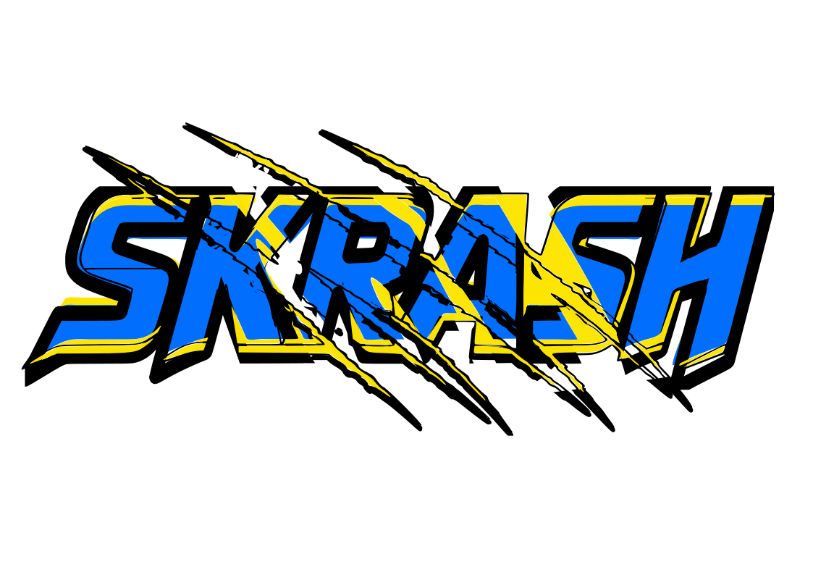

<p align="center">      
        
</p>      
      
# SKRASH     
      
**skrash** is a native Scratch 3.0 (`.sb3`) project runtime and executor.      
             
## Requirements      
      
- `libzip`      
- `SDL2`      
      
## Build & Run      
      
### Tests      
      
```bash      
make ctest      # C tests      
make pytest     # Python tests      
make clean  
```    
  
      
### Skrash Player         
```bash      
make play      
./build/skrash-play path/to/project.sb3      
```
      
## Python API (example)      
```python     
import skrash

project = skrash.load("game.sb3")

player = project.sprites["Player"]
score = project.variables["Score"]


@skrash.when_green_flag_clicked
def start():
    player.show()
    player.x = 0
    player.y = 0
    player.direction = 90

    score.value = 0
    player.say("Let's play!")

    player.move(50)
    score.value += 1


project.run()
```   
  
      
## Status      
      
See **[Todo.md](Todo.md)** for the detailed list of implemented Scratch blocks and remaining work.  

## Documentation

- [Python API](docs/api.md)
      
## License

licensed under the MIT License