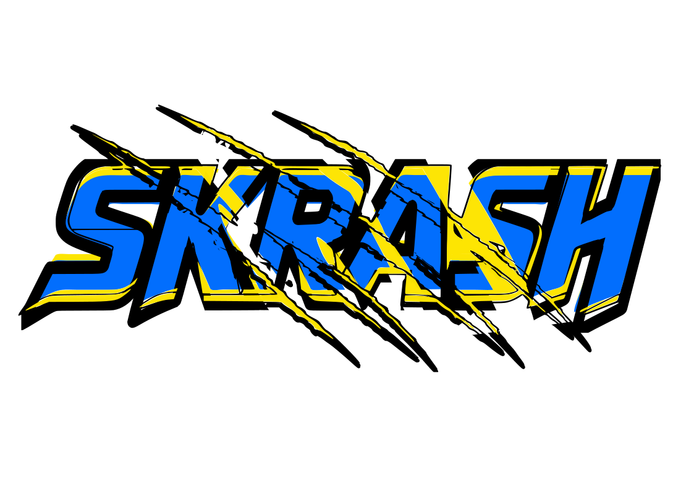

<p align="center">
  
</p>

# SKRASH

**Skrash** is a native Scratch 3.0 runtime that executes `.sb3` projects. It also provides an optional Python API for control, debugging, and automation.

## Requirements

- GCC
- GNU Make
- Python 3 and `python3-config`
- SDL2 development libraries
- libzip development libraries
- pytest (for running the Python tests)

## Build and Test

Build the native Python extension and compile the C test executables:

```bash
make
```

Run the complete test suite:

```bash
make test
```

This runs both the native C tests and the Python tests.

You can also run the test suites individually:

```bash
make ctest   # Build and run C tests
make pytest  # Build the native extension and run Python tests
```

Clean generated build files:

```bash
make clean
```

## Skrash Player

Build the standalone player:

```bash
make play
```

Run it with an SB3 project:

```bash
./build/skrash-play path/to/project.sb3
```

## Runtime Design References

Skrash's runtime is developed with Scratch 3.0 compatibility as its primary goal. Its behavior and implementation decisions are guided by:

- [Scratch VM source code and behavioral tests](https://github.com/scratchfoundation/scratch-editor/tree/develop/packages/scratch-vm): The official Scratch VM implementation and its test suite.
- [Scratch Specification](https://scratchspec.github.io/full/): An independent reference documenting Scratch 3.0's behavior and semantics.

These references help guide implementation decisions and validate behavioral compatibility with Scratch.

## Python API

The Python API can be used to load and control Scratch projects programmatically.

```python
import skrash

project = skrash.load("game.sb3")

player = project.sprites["Player"]
score = project.variables["Score"]


@skrash.when_green_flag_clicked
def start():
    player.show()
    player.x = 0
    player.y = 0
    player.direction = 90

    score.value = 0
    player.say("Let's play!")

    player.move(50)
    score.value += 1


project.run()
```

See the [Python API documentation](docs/api.md) for details about the currently available API.

For additional ideas about how the Python API could evolve, see [Python API Ideas](docs/api_ideas.md). This file is a collection of design ideas inspired by the way the official Scratch editor organizes projects, sprites, the stage, and variables. It is not documentation of implemented features or a specification of the current API.

## Project Status

See [Todo.md](Todo.md) for the detailed list of implemented Scratch blocks and remaining work.

## Contributing

Contributions are welcome! Please read the [Contributing Guide](CONTRIBUTING.md) before opening an issue or submitting a pull request.

## License

Skrash is licensed under the [MIT License](LICENSE).
